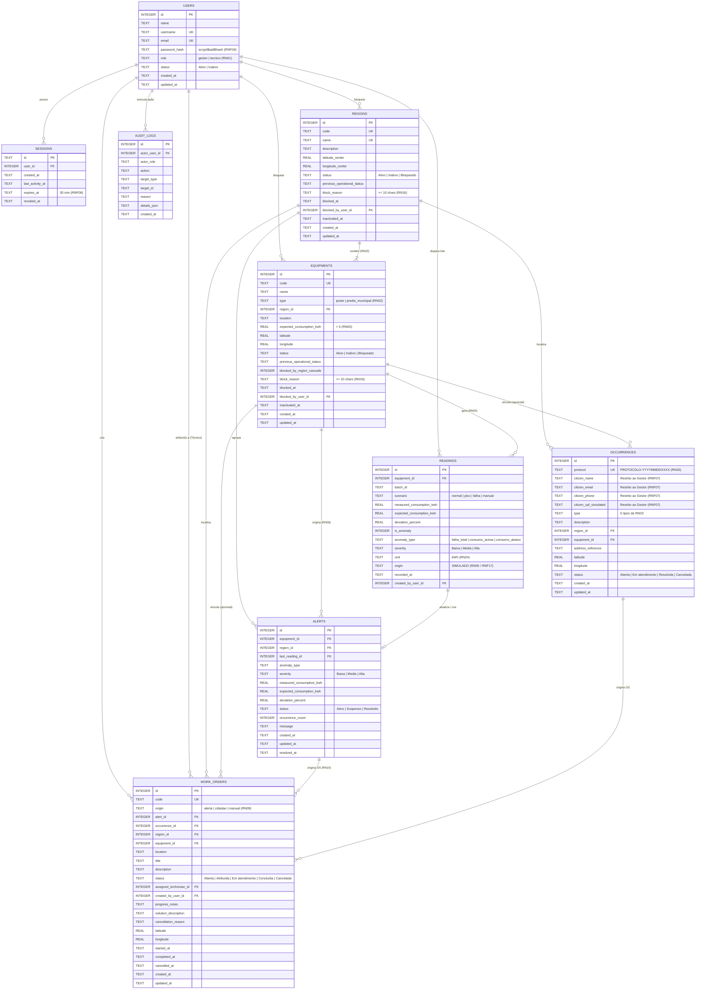

# Modelagem de Dados e Diagrama Entidade-Relacionamento (DER) — SGE-Urbano

## 1. Visão Geral da Modelagem

O banco de dados relacional do **SGE-Urbano** foi projetado em **SQLite** (via módulo nativo `node:sqlite` do Node.js `v22+`) com ativação estrita de integridade referencial (`PRAGMA foreign_keys = ON`) e políticas `ON DELETE RESTRICT` em todas as chaves estrangeiras para garantir a preservação histórica exigida por `RN04`, `RN14`, `RN20` e `RNF02`.

---

## 2. Diagrama Entidade-Relacionamento (DER)

---

## 3. Regras de Integridade Impostas no Próprio Banco de Dados

1. **Prevenção de Duplicidade de Alertas Ativos (`RN08`, `CA07.3`, `CT07`):**
   - Índice único parcial `idx_alerts_unique_active_per_equip_type` sobre `(equipment_id, anomaly_type) WHERE status IN ('Ativo', 'Suspenso')`.
2. **Prevenção de Segunda OS Ativa para o Mesmo Alerta (`RN19`, `CA09.3`, `CT09`, `CT12`):**
   - Índice único parcial `idx_work_orders_unique_active_per_alert` sobre `(alert_id) WHERE alert_id IS NOT NULL AND status IN ('Aberta', 'Atribuída', 'Em atendimento')`.
   - Quando uma OS vinculada a um alerta é `Cancelada` (`RN25`) ou `Concluída`, ela deixa de ocupar o índice parcial, permitindo abrir uma nova OS caso o alerta permaneça `Ativo`.
3. **Proibição de Exclusão Física (`RN14`, `RNF02`, `CT17`):**
   - Todas as chaves estrangeiras usam `ON DELETE RESTRICT`.
   - Triggers `trg_prevent_delete_alerts`, `trg_prevent_delete_occurrences` e `trg_prevent_delete_work_orders` bloqueiam comandos `DELETE` físicos em operação normal, permitindo limpeza somente dentro da transação controlada de `resetAndSeedDatabase()` quando `NODE_ENV === 'test'` (`RNF20`).
4. **Validação de Domínio por `CHECK` Constraints:**
   - `equipments.expected_consumption_kwh > 0` (`RN03`, `CT03`).
   - `readings.origin = 'SIMULADO'` e `readings.unit = 'kWh'` (`RN05`, `RN24`, `RNF17`).
   - `users.password_hash LIKE 'scrypt$%'` (`RNF04` — impede gravação de senha em texto claro).
   - `regions.block_reason` e `equipments.block_reason` com `length(trim(block_reason)) >= 10` (`RN16`, `OD-09`, `CT18`).
